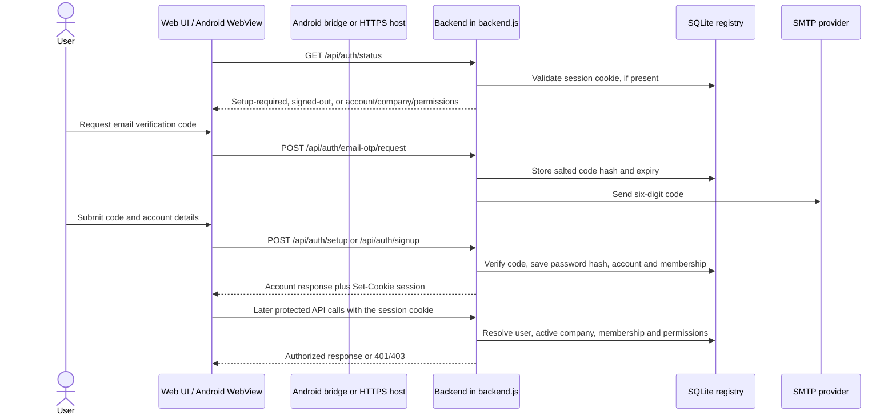

# Authentication and session handling

## Scope

This walkthrough describes the authentication implementation in the local itsme invoicey source snapshot, not a deployed security audit. At the time this documentation was added, the connected `itsmesto/webapp` GitHub repository had no application source. The paths below refer to the local source layout. This commit adds documentation only; it does not upload databases, customer data, build outputs, signing files, environment files, or the application source.

## Components

| Component | Responsibility |
| --- | --- |
| `public/index.html`, `public/app.js`, `public/api-config.js` | Render sign-in, sign-up, email verification and recovery; send API requests. |
| `android/app/src/main/assets/business/backend.js` | Bundled API implementation for account checks, passwords, OTPs, sessions, company membership and authorization. |
| `android/runtime/entry.mjs`, `android/runtime/http.mjs` | Route same-origin API calls to the embedded Android backend and carry the session cookie between requests. |
| `android/app/src/main/java/com/itsme/invoicey/MainActivity.java`, `NativeStorage.java` | Host the WebView, handle hosted-mode cookies and provide app-private storage to the local runtime. |
| `hosting/server.mjs`, `hosting/http-security.mjs` | Configure SMTP and storage, import the bundled backend for hosted mode, and add hosted HTTP, CORS and write-origin protections. |

The hosted startup path imports the bundled `backend.js`. `server/access-control.mjs` is a separate older module and is not imported by `hosting/server.mjs`; it should not be mistaken for the implementation served by that wrapper.

## Request flow

1. On startup, the UI calls `GET /api/auth/status`. The backend checks the current session and returns first-time setup, signed-out, or authenticated account/company/permission state.
2. Registration and first-time setup request a verification code through `POST /api/auth/email-otp/request`. The six-digit code is scoped to an email and purpose, expires after 10 minutes, and has a five-attempt limit. A salted scrypt hash is stored; SMTP settings come from the host environment.
3. The UI sends the code and account details to `/api/auth/signup` or `/api/auth/setup`. The backend validates the code and password, stores the password hash, creates the user and company membership, then issues a session.
4. Sign-in posts username and password to `/api/auth/login`. The backend compares a salted scrypt hash, rate-limits attempts, resolves company membership and issues a new session. Password recovery requests an OTP with purpose `password-reset`, then calls `/api/auth/recover`.
5. Protected requests authenticate from the session cookie. The backend resolves the active company and membership and enforces role permissions server-side; hiding a button in the UI is not an authorization check.
6. Sign-out calls `/api/auth/logout`, deletes the current server-side session and expires the cookie. Password recovery revokes all of that user’s sessions. Changing a password revokes other sessions while keeping the current one.

## How credentials and tokens are handled

- **Passwords:** Sent to the API only for setup, sign-in, or password change/recovery. The backend uses a per-password random salt and stores a scrypt-derived hash plus salt in SQLite. It does not return the hash or store a reversible password. The UI and backend enforce a 12-character minimum.
- **Email verification codes:** Generated as six-digit values, salted and scrypt-hashed for storage with their email, purpose, expiry and attempt count. The code is sent through configured SMTP and removed after successful use or expiry. Requests and verification attempts are rate-limited.
- **Session token:** A 32-byte random opaque token is generated after successful authentication. SQLite stores only its SHA-256 hash in the `sessions` table. The raw token is issued as the `invoicey_session` cookie; it is not a JWT, OAuth token, or JSON bearer token.
- **Cookie lifetime and flags:** The cookie uses `HttpOnly`, `Path=/` and a 12-hour `Max-Age`. The database session also expires after 12 hours and its expiry is extended on valid requests. Hosted mode defaults to `SameSite=None; Secure` for cross-origin Android/API requests. Setting `INVOICEY_COOKIE_SECURE=0` disables `Secure` and is unsuitable for production HTTPS. The non-hosted local runtime uses `SameSite=Lax`.
- **Hosted web and remote Android:** With an API base configured, the UI uses `fetch(..., { credentials: 'include' })`. Android’s `CookieManager` accepts cookies, including third-party cookies needed for cross-origin hosted mode. The server needs HTTPS and an exact origin allowlist; wildcard CORS cannot be used with credentialed requests.
- **Offline Android:** The embedded runtime intercepts same-origin API calls, saves the cookie string under `invoicey_session` through the `InvoiceyNative` bridge, then attaches it to later internal requests. The bridge uses Android `SharedPreferences` with `Context.MODE_PRIVATE`. This is app-private storage; the source snapshot does not use an application-level encrypted-preferences API for this token.
- **SMTP credentials and secrets:** SMTP configuration is supplied through the hosting environment and is not embedded in the Android package. Do not commit environment files, signing keys, passwords, raw session tokens, OTPs, or database files.

## Hosted request protections

`hosting/http-security.mjs` applies response security headers and `Cache-Control: no-store` to API responses. For hosted state-changing API calls, it checks `Origin` or `Referer` against configured exact origins and rejects cross-site writes. `hosting/server.mjs` configures the allowed origins and HTTPS cookie behavior. These hosted-wrapper controls are separate from the local Android API, which is dispatched inside the app.

## Source-of-truth and reproducibility

In this local snapshot, the authentication logic used by the hosted wrapper and Android package is present in the bundled `backend.js` artifact. The README describes a source/build layout, but the snapshot does not include the top-level `server.mjs` imported by the Android runtime entry. Restore or document the build input before treating the snapshot as a clean, reproducible source repository. Keep databases, temporary QA data, build outputs, signing files and environment secrets out of Git.
