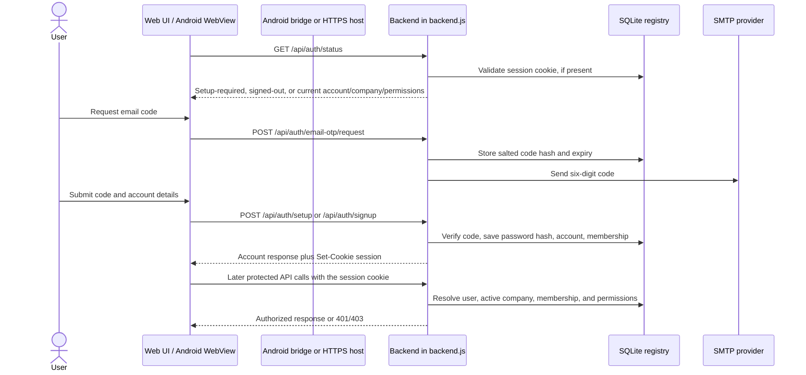

# Authentication and session handling

This document describes the authentication behavior visible in the local itsme invoicey source snapshot. The runtime backend is bundled as `android/app/src/main/assets/business/backend.js`; the hosted wrapper imports that same bundle. This is a code walkthrough, not a penetration-test report or a claim that every deployed build matches this snapshot.

## Components

| Component | Responsibility |
| --- | --- |
| `public/index.html`, `public/app.js`, `public/api-config.js` | Render setup, sign-in, sign-up, email-code, and password-recovery screens; send API requests. |
| `android/app/src/main/assets/business/backend.js` | Implements the API routes, account checks, password verification, email OTPs, sessions, company membership, and permissions. |
| `android/runtime/entry.mjs`, `android/runtime/http.mjs` | In the packaged Android runtime, route same-origin `/api/` fetches into the embedded backend and carry its session cookie between requests. |
| `android/app/src/main/java/com/itsme/invoicey/MainActivity.java`, `NativeStorage.java` | Host the WebView, enable its cookie handling for hosted mode, and provide app-private storage to the local runtime. |
| `hosting/server.mjs`, `hosting/http-security.mjs` | Configure SMTP and storage, import the same backend bundle for hosted mode, and add hosted HTTP, CORS, and write-origin protections. |

The runtime path in `hosting/server.mjs` imports the bundled `backend.js`. `server/access-control.mjs` is a separate older module and is not imported by that startup path; it should not be treated as the implementation currently served by this wrapper.

## Request flow

1. The UI starts with `GET /api/auth/status`. The backend validates the current session and returns either first-time setup state, signed-out state, or the authenticated user’s company and permission context.
2. Sign-up and first-time setup request an email verification code before account creation. The code is scoped to an email and purpose, expires after 10 minutes, and has a five-attempt verification limit. The backend stores a salted scrypt hash, not the code itself. SMTP settings are supplied by the host environment; they are not embedded in the Android package.
3. The UI submits the code and account details to `/api/auth/signup` or `/api/auth/setup`. The backend validates the OTP and password requirements, stores a salted password hash, creates the user and company membership, then creates a session.
4. Sign-in posts the username and password to `/api/auth/login`. The backend checks a salted scrypt hash, applies rate limiting, chooses an authorized company, and issues a new session. Password-reset codes use `/api/auth/email-otp/request` with `password-reset`, followed by `/api/auth/recover`.
5. Each protected request is authenticated from the session cookie. The backend resolves the active company and membership and enforces the resulting role permissions server-side; UI visibility is not the authorization boundary.
6. Sign-out deletes the current server-side session and expires the cookie. Password recovery removes all sessions for that user. A password change keeps the current session and removes the user’s other sessions.

## Passwords, codes, and tokens

- **Passwords:** The API receives the password only for the relevant setup, sign-in, or change/reset request. The backend generates a per-password random salt and stores a scrypt-derived hash and salt in SQLite. It does not store a reversible password or return the password hash to the UI. The UI enforces a 12-character minimum, and the backend independently checks it.
- **Email OTPs:** The backend generates a six-digit code, creates a random salt, and stores the scrypt hash, purpose, email, expiry, and attempt counter in SQLite. It sends the code through the configured SMTP transport. Codes are limited by request rate and verification attempts and are deleted after successful use or expiry.
- **Session token:** After successful login/setup, the backend creates a 32-byte random opaque token. SQLite stores only its SHA-256 hash in the `sessions` table. The raw token is returned as an `invoicey_session` cookie; it is not a JWT, OAuth token, or bearer token in JSON.
- **Cookie lifetime:** The cookie has `HttpOnly`, `Path=/`, and a 12-hour `Max-Age`. The server also expires the database session after 12 hours and extends its expiry when a valid request is made. In hosted mode the default is `SameSite=None; Secure` for cross-origin Android/API requests; `INVOICEY_COOKIE_SECURE=0` disables the `Secure` attribute and should not be used on production HTTPS. The non-hosted local runtime uses `SameSite=Lax`.
- **Hosted web and remote Android:** The UI uses `fetch` with `credentials: 'include'` when an API base URL is configured. Android’s `CookieManager` accepts cookies, including third-party cookies required for cross-origin hosted mode. The host must use HTTPS and an exact CORS origin allowlist; wildcard CORS is not compatible with credentialed requests.
- **Offline Android:** The bundled runtime intercepts same-origin API calls. It keeps the returned cookie string in the `invoicey_session` key using the `InvoiceyNative` bridge, backed by `SharedPreferences` created with `Context.MODE_PRIVATE`, and adds the cookie to later internal requests. This is OS app-private storage; the source does not use an application-level encrypted-preferences API for this value.

## Hosted request protections

`hosting/http-security.mjs` applies response security headers and `Cache-Control: no-store` to API responses. For hosted state-changing API calls, it checks `Origin` or `Referer` against configured exact origins and rejects cross-site writes. `hosting/server.mjs` configures the allowed origins and HTTPS cookie behavior. These protections apply to the hosted HTTP wrapper; the local Android API is dispatched inside the app rather than sent over the network.

## Source-of-truth note

The authentication logic used by the hosted wrapper and Android package is currently present in the bundled `backend.js` artifact. The README describes a source/build layout, but this local snapshot does not include a top-level `server.mjs` that the Android runtime entry imports. Before treating this folder as a clean, reproducible source repository, restore or document the build input for that bundle and exclude databases, temporary QA data, build outputs, signing files, and environment secrets.

